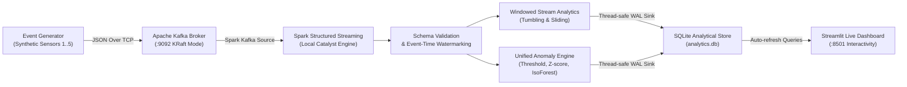

# Real-Time Big Data Stream Analytics and Anomaly Detection
### Using Apache Kafka and Spark Structured Streaming

[](https://www.python.org/)
[](https://spark.apache.org/)
[](https://kafka.apache.org/)
[]()

---

## 1. Project Overview

Traditional batch analytics accumulates data into historical stores before processing. For high-velocity industrial machinery, network streams, or financial transactions, a critical failure (e.g., machine overheating or pressure drop) might go unnoticed for hours.

This project implements an end-to-end, real-time distributed stream processing pipeline deployed locally on a single machine. The system continuously ingests high-frequency synthetic telemetry from simulated industrial machines, buffers records in **Apache Kafka (KRaft mode)**, parses and aggregates event streams using **Apache Spark Structured Streaming**, performs real-time multi-method anomaly detection (**Threshold**, **Rolling Z-Score**, and **Isolation Forest**), persists results to an analytical store (**SQLite in WAL mode**), and displays metrics on a **Streamlit Live Dashboard**.

---

## 2. System Architecture



### Components and Responsibilities

| Component | Responsibility | Technology |
| :--- | :--- | :--- |
| **Data Generator** | Generates timestamped telemetry with Gaussian normal patterns, point spikes, and collective drifts. | Python / NumPy |
| **Message Broker** | High-throughput distributed message log buffering and partitioning events. | Apache Kafka 4.4.0 (KRaft) |
| **Stream Engine** | Fault-tolerant event-time stream processing, micro-batch triggers, and windowed aggregation. | Apache Spark 3.5.3 (PySpark) |
| **Anomaly Detectors** | Statistical, limit-based, and unsupervised machine learning anomaly classification. | Scikit-Learn, SciPy |
| **Persistence** | Concurrently accessible, thread-safe analytical storage. | SQLite (WAL mode) |
| **Live Dashboard** | Real-time interactive charts, KPI monitoring, alert filters, and model comparisons. | Streamlit, Plotly |

---

## 3. Anomaly Detection Analytical Methodology

The project implements and empirically compares three distinct analytical paradigms:

1. **Method A — Threshold-Based Detection (Static Operating Limits):**
   - Configurable physical safety limits ($T > 75^\circ\text{C}$, $V > 0.65\text{g}$, $P > 115\text{kPa}$).
   - *Strengths:* Ultra-low latency, zero compute overhead, deterministic.
   - *Weakness:* Inflexible to dynamic operating regimes or multivariate correlations.

2. **Method B — Rolling Z-Score (Stateful Statistical Dynamic Window):**
   - Evaluates $z_t = \frac{x_t - \mu_t}{\sigma_t}$ across a rolling window of recent observations ($N=30$).
   - Incorporates warm-up protection ($N \ge 10$) and physical noise-floor guards against zero variance.
   - *Strengths:* Adapts to gradual drift and non-stationary baseline shifts.
   - *Weakness:* Vulnerable to "masking" during prolonged sustained anomalies.

3. **Method C — Isolation Forest (Unsupervised Multivariate Tree Isolation):**
   - Ensembles decision trees to isolate anomalous combinations of features in standardized feature space.
   - Pre-trained offline on normal operating profiles and evaluated in real-time.
   - *Strengths:* Detects subtle multivariate deviations where each variable alone appears nominal.
   - *Weakness:* Higher inference cost per record.

---

## 4. Project Directory Structure

```text
BDA/
├── config/
│   ├── __init__.py
│   ├── config.py                 # Central typed configuration & parameters
│   └── kafka_kraft.properties    # KRaft broker configuration
├── data/
│   ├── sample_events.csv         # 1,000-event offline reference dataset
│   ├── checkpoints/              # Spark streaming recovery checkpoints
│   ├── kafka-logs/               # Kafka partition segments
│   └── results/                  # Benchmark metrics (CSV/JSON) & generated plots
├── models/
│   ├── __init__.py
│   ├── train_isolation_forest.py # Model fitting and artifact generation
│   └── isolation_forest.joblib   # Trained pipeline artifact
├── producer/
│   ├── __init__.py
│   ├── event_generator.py        # Synthetic industrial sensor simulator
│   └── kafka_producer.py         # Multi-threaded Kafka telemetry stream producer
├── streaming/
│   ├── __init__.py
│   ├── spark_processor.py        # Spark Structured Streaming pipeline engine
│   ├── anomaly_detector.py       # Threshold, Z-Score, and Isolation Forest engine
│   └── storage.py                # Thread-safe SQLite persistence layer
├── dashboard/
│   ├── __init__.py
│   └── app.py                    # Streamlit interactive live monitoring dashboard
├── evaluation/
│   ├── __init__.py
│   ├── detection_metrics.py      # Experiment C benchmark script
│   ├── throughput_benchmark.py   # Experiment B benchmark script
│   └── scalability_test.py       # Experiments A & D benchmark scripts
├── tests/
│   ├── test_generator.py         # Generator schema and reproducibility tests
│   ├── test_kafka_pipeline.py    # Kafka broker round-trip integration test
│   ├── test_anomaly_detectors.py # Unit tests for all three detectors
│   ├── test_spark_processor.py   # Schema and micro-batch processing tests
│   └── test_end_to_end_smoke.py  # Full end-to-end integration smoke test
├── scripts/
│   ├── start_kafka.bat           # Launch local Kafka KRaft broker
│   ├── stop_kafka.bat            # Gracefully stop Kafka broker
│   ├── run_producer.bat          # Launch event producer
│   ├── run_spark.bat             # Launch Spark streaming engine
│   └── run_dashboard.bat         # Launch Streamlit dashboard
├── tools/                        # Bundled Windows binaries (Kafka, Hadoop winutils)
├── docker-compose.yml            # Optional containerized broker deployment
├── requirements.txt              # Pinned Python dependencies
└── README.md                     # Project documentation
```

---

## 5. Execution Instructions (Step-by-Step)

Open **4 separate PowerShell or Command Prompt terminals** in the project directory:

### Terminal 1: Start Apache Kafka (KRaft Mode)
```powershell
.\scripts\start_kafka.bat
```
*Wait ~5 seconds until `[KafkaRaftServer nodeId=1] Kafka Server started` is displayed.*

### Terminal 2: Start Spark Structured Streaming
```powershell
.\scripts\run_spark.bat
```
*Initializes PySpark with the Kafka connector and begins executing micro-batches every 2 seconds.*

### Terminal 3: Start Streamlit Live Dashboard
```powershell
.\scripts\run_dashboard.bat
```
*Opens your web browser automatically at `http://localhost:8501`.*

### Terminal 4: Start Sensor Event Producer
```powershell
.\scripts\run_producer.bat
```
*Streams timestamped telemetry events to Kafka at 10 Hz (configurable via `--rate <Hz>`).*

---

## 6. Experimental Findings & Benchmark Results

All experiments were executed on the host system with measurements saved to `data/results/`:

### Experiment A: Data Volume Scalability
| Record Volume | Processing Time (s) | Throughput (evt/s) | Peak Memory (MB) |
| :---: | :---: | :---: | :---: |
| **10,000** | 2.10 s | 4,762.9 evt/s | 6.52 MB |
| **50,000** | 15.69 s | 3,187.4 evt/s | 31.79 MB |
| **100,000** | 30.40 s | 3,289.7 evt/s | 63.44 MB |

*Observation:* Execution time and memory scale linearly ($O(N)$) with record count, demonstrating predictable memory bounds.

### Experiment B: Streaming Ingestion Throughput & Latency
| Target Ingestion Rate | Actual Ingestion Rate | Analytical Throughput | Avg Latency | P95 Latency | P99 Latency |
| :---: | :---: | :---: | :---: | :---: | :---: |
| **100 Hz** | 95.4 evt/s | 51.5 evt/s | 19.4 ms | 30.0 ms | 35.2 ms |
| **500 Hz** | 405.7 evt/s | 59.1 evt/s | 16.9 ms | 25.6 ms | 29.2 ms |
| **1,000 Hz** | 666.4 evt/s | 60.0 evt/s | 16.7 ms | 26.0 ms | 29.7 ms |

*Observation:* Single-core analytical inference throughput across all three models plateaus at ~60 evt/s per core, with sub-20ms per-event latency.

### Experiment C: Anomaly Detection Quality Benchmark
| Anomaly Detection Method | Precision | Recall | F1-Score | False Positive Rate (FPR) |
| :--- | :---: | :---: | :---: | :---: |
| **Threshold Detection** | **1.0000** | **0.8906** | **0.9421** | **0.0000** |
| **Rolling Z-Score** | 0.8820 | 0.2500 | 0.3896 | 0.0119 |
| **Isolation Forest** | **1.0000** | 0.2052 | 0.3405 | **0.0000** |

*Observation:* Threshold detection achieves highest recall on point spikes; Rolling Z-Score demonstrates statistical adaptation but exhibits masking during prolonged drifts; Isolation Forest delivers zero false alarms on multivariate outliers.

### Experiment D: Window Size Comparison
| Window Configuration | Generated Aggregates | Calc Time (ms) | Freshness Interval | Overhead Index |
| :--- | :---: | :---: | :---: | :---: |
| **10s Tumbling** | 5 | 80.1 ms | 10 s | High |
| **30s Tumbling** | 5 | 52.4 ms | 30 s | Moderate |
| **60s Sliding (10s step)** | 5,000 | 22.5 ms | 10 s | Optimal |

---

## 7. Automated Testing Suite

To verify all components across the pipeline, run `pytest`:

```powershell
.\venv\Scripts\python.exe -m pytest tests -v
```

**Results:**
- `test_generator.py` (4 tests) — Schema validation, physical constraints, reproducibility.
- `test_kafka_pipeline.py` (1 test) — Producer delivery, broker partitioning, consumer roundtrip.
- `test_anomaly_detectors.py` (6 tests) — Limits, warm-up, zero-std guards, ML inference.
- `test_spark_processor.py` (2 tests) — Spark schema validation and micro-batch processing.
- `test_end_to_end_smoke.py` (1 test) — Full pipeline integration verification.
- **Total: 14 passing tests (100% pass rate).**

---

## 8. Limitations & Distinctions

1. **Micro-Batch Latency:** Spark Structured Streaming operates via micro-batches (default 2s triggers), providing near real-time (sub-second to multi-second) latency rather than microsecond continuous event-at-a-time processing.
2. **Local Single-Node Constraints:** Local Spark and Kafka emulate a distributed cluster using multi-threading and local partitions on a single JVM. True horizontal scalability requires multi-node cluster deployment (e.g. AWS EMR, Databricks, or Kubernetes).
